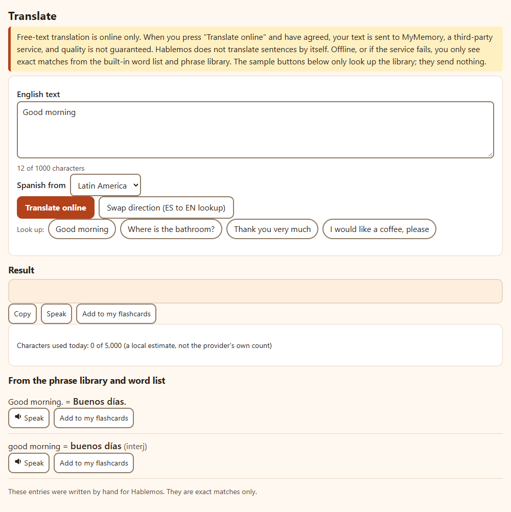

# Hablemos

Hablemos ("let's talk") is a free, browser-only Spanish learning tool for English speakers. Translate sentences online (with your consent), browse about a thousand words and three hundred phrases, review flashcards with spaced repetition, take quizzes, and rehearse short conversations. There is no server, no account and no tracking. Open `index.html` or host the folder on GitHub Pages.

Live demo: https://anirudhkaushik0211.github.io/hablemos/



## Why it exists

Most language apps need an account, send your activity somewhere, or hide the grammar. Hablemos keeps your progress on your device and teaches with hand-written vocabulary, phrases, verb tables, flashcards and quizzes. It offers optional online translation, only after you consent, and is honest about what it cannot do. It is also a small, readable example of a dependency-free static web app.

## Features

- **Translate (English to Spanish, online only).** Free text goes to MyMemory after a one-time consent prompt; the daily limit counter, optional email and chunking are described below. Offline or on failure only exact matches from the word list and phrase library are shown, never generated Spanish. Spanish to English lookup works offline.
- **No invented Spanish.** The app never builds Spanish sentences itself; library matches are hand-written entries.
- **Spain or Latin America.** One switch changes variant words (coche or carro, ordenador or computadora) and vosotros or ustedes.
- **Copy, speak, add to flashcards, and a Spanish to English lookup** for words and phrases the dictionary knows.
- **Learn.** 1,040 words in A1, A2 and B1 tiers across 26 categories; 319 phrases in 8 situations; 30 false friends; 37 idioms with literal translations; 14 pronunciation tips; numbers, dates and time; cognates; a deterministic word of the day. Search ignores accents. Mark words as learned.
- **Flashcards.** Decks by topic, level, "My cards", "Mistakes" and "Due today". Flip animation (removed under reduced motion), Again, Hard, Good and Easy, three modes (English to Spanish, Spanish to English, audio first), daily goal and streak, keyboard shortcuts.
- **Quizzes.** Multiple choice, typing (accent-insensitive with a hint), listening, matching pairs, conjugation gym (present, preterite, imperfect, future, commands), sentence unscramble, false-friend quiz, a 60-second sprint and a seeded daily challenge. XP, levels, badges and a mistake notebook that feeds the flashcards.
- **Scenarios.** Four branching dialogues (café, directions, hotel, pharmacy) where you pick or type the best Spanish reply and can replay the audio.
- **Progress and settings.** Stats, a 12-week streak calendar, badges, export and import as JSON, reset, theme (light, dark, auto), text size, sound, slow speech, daily goal, reduced motion.
- **Optional online translation** (off by default, see below).
- **Accessible.** Labelled controls, keyboard operation (tabs use the arrow keys), visible focus, `aria-live` feedback, `lang="es"` on Spanish text, reduced motion, responsive from 320 px.

## How translation works, and its limits
Hablemos has no translator of its own for free text. The earlier offline word-by-word translator was removed by an owner decision (recorded in `docs/SPEC.md`, section 0). Free-text translation goes only through MyMemory, an online third-party service, and only after you agree to a consent notice that says your typed text is sent to that service and that quality is not guaranteed. Nothing is sent before you agree.
When you are offline, blocked, over the daily limit, or the request fails, Hablemos does **not** generate any Spanish. It shows only exact matches from the hand-written word list and phrase library (`js/curated.js`) and a clear message. When an online result is shown, the matching library phrase (if there is one) appears next to it.
**Accuracy.** The curated data (words, phrases, idioms, false friends, scenarios) is held to a gate of 0 errors in a reviewed sample. Online output is third-party and is not covered by any accuracy claim or gate. The offline translator evaluation was retired with the translator; see [docs/EVAL.md](docs/EVAL.md) for the data statistics that `npm run eval` still produces.

## Privacy

- Everything runs in your browser and is stored in `localStorage` on your device. No analytics, no cookies, no account.
- With online translation off (the default) the page makes no network requests beyond loading its own files. A Content Security Policy in `index.html` allows connections only to one origin, `https://api.mymemory.translated.net`, and nothing else.
- Export and import move your progress as a JSON file you control. The export never contains the optional email or the online usage counter.

## Optional online translation (MyMemory)

Online translation is the only way to translate free text, and it needs your consent. The first time you press "Translate online" a dialog explains that the text is sent to MyMemory, a third-party service, and that quality is not guaranteed; press "I agree" to continue or Cancel to send nothing. Text is sent only when you press the button; never while typing, never on page load. Withdraw consent in Progress, Settings, "Online translation".
- **What is sent.** The English text (in chunks of at most 200 characters, sentence by sentence) and, if you saved one, your email as the provider's `de` parameter. The provider is a third party and may log requests. Terms: <https://mymemory.translated.net/doc/spec.php>.
- **When it helps.** Sentences, words or idioms outside the built-in library.
- **When not to use it.** Private text, high-stakes text (legal, medical, safety), heavy use, and when you are offline.
- **Daily limits.** The provider publishes 5,000 characters per day for anonymous use and 50,000 per day when a valid email is supplied. Hablemos counts characters locally per calendar day ("Characters used today: X of N") and does not send text that would exceed what is left; it shows the library matches and a message instead. The counter is a local convenience, not the provider's accounting. Personal projects are not eligible for provider whitelisting, so nothing above 50,000 is assumed. The limit values are constants at the top of `js/online.js`.
- **Optional email.** Settings has a blank "Email for a higher daily limit" field. If you fill in a valid address it is stored only in your browser's `localStorage`, sent only as `de` in your own online requests, never logged, never exported and never written to any file in this repository. "Clear email" removes it.
- **Chunking.** The 200-character chunk size is an implementation choice, not a documented provider limit. If the provider reports a too-long query, the chunk is split in halves (up to three levels) and retried. Chunks are sent one at a time and reassembled in order.
- **Quality.** The provider sometimes returns noisy memory matches. When the response includes a match score below 0.5 (or, without it, a best match quality below 50) a "low confidence" badge is shown. These two thresholds are implementation choices. Online results are never presented as certified, and no accuracy claim is made for them.
- **Library match.** If a library phrase or word matches your text exactly, it is shown next to the online result. There is no offline translation to compare with.
- **Failures.** Rate limit, quota exceeded, too long, offline, timeout (10 s) and malformed replies each show a clear message and show the library matches only.

## Use it offline or online

- **Double-click `index.html`.** Works from `file://` in current Edge, Chrome and Firefox. All scripts are classic deferred scripts (no modules, no fetch of local files).
- **Or serve the folder:** `node scripts/serve.cjs` (binds `127.0.0.1` only) and open the printed address.

## Deploy your own on GitHub Pages

1. Create a new public repository named `hablemos` on GitHub. Tick "Add a README" off, choose the MIT licence and the Node `.gitignore` template when creating it.
2. Upload the contents of this folder, but skip `LICENSE` and `.gitignore` (GitHub already created them). Keep the `.nojekyll` file; if it was skipped, use "Add file", "Create new file" and name it `.nojekyll`.
3. In the repository open Settings, Pages. Under "Build and deployment" choose "Deploy from a branch", branch `main`, folder `/ (root)`, and save.
4. After a minute the site is live at `https://<your-username>.github.io/hablemos/`.
5. Edit the "Live demo" line near the top of this README to point to that address.
6. Replace the `[your name]` placeholder in `LICENSE` with your name.

## Data and licensing

All words, phrases, examples, dialogues and notes were authored originally "from standard grammar". No dictionary, textbook, app, website or open dataset was copied. See [docs/DATA-SOURCES.md](docs/DATA-SOURCES.md). The project is released under the MIT licence (see `LICENSE`).

Content counts: 1,040 words (A1 378, A2 403, B1 259), 319 phrases, 162 verbs in the conjugation engine (36 with hand-authored reference tables for all five tenses), 30 false friends, 37 idioms, 14 pronunciation tips, 4 scenarios.

## FAQ

**Is this a real translator?** No. Free text is translated by a third-party online service (MyMemory) that Hablemos does not control. Use a professional translator or a human for anything that matters.


**Does it work offline?** Yes, except free-text translation, which needs a network and your consent.

**Where is my progress?** In your browser's `localStorage`. Clearing site data erases it, so export a backup from the Progress tab.

**Why no sound?** Speech uses your browser's built-in voices. If no Spanish voice is installed you see a message and the text instead. TTS voices vary by device and were not verified across devices.

**Can I use it on a phone?** Yes. The layout is responsive and targets are at least 40 px.

**Voseo, past tenses, the subjunctive?** Out of scope for now.

## Developer API and CLI

```js
const H = require('./js/api.js');
H.curatedLookup('good morning', 'la');                             // exact library matches only: { phrase, words, message }
H.reverseLookup('casa', 'la');
H.conjugate('tener', 'pres');                                      // ['tengo', 'tienes', ...]
H.pluralize('canción');                                            // 'canciones'
H.numberToWords(21);                                               // 'veintiuno'
H.rate(state, 'good', today);                                      // spaced-repetition scheduler
H.makeQuiz('mc', { seed: 7 });
H.dailyChallenge('2026-03-04');
H.wordOfTheDay('2026-03-04');
H.buildOnlineRequest('Hello', '');                                 // { url, method }
H.parseOnlineResponse(json);                                       // { ok, text, match, lowConfidence } or { ok: false, reason }
```


Commands (Node 22 or newer, no packages to install): `npm test`, `npm run eval`, `npm run smoke` (headless Edge and Firefox, file and http; never contacts the real translation service), `npm run screenshots`, `npm run package`.

## Contributing

Issues and pull requests are welcome. Please keep the project dependency-free and classic-script compatible (no modules, ES2018 syntax in `js/` and `data/`), write all content originally, run `npm test`, and never add an e-mail address, name or local path to the repository.

## License

MIT. See `LICENSE`.
